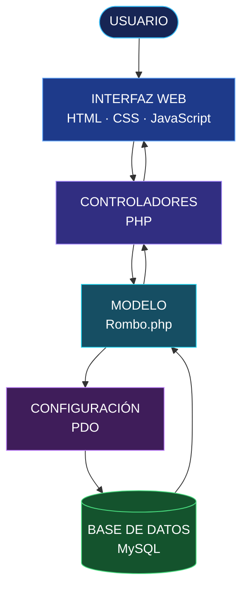

 <div align="center">


<br>

**Una herramienta digital para calcular, registrar y administrar propiedades geométricas.**

<br>


</div>

---

<div align="center">

# ◈ 01 — VISIÓN DEL PROYECTO

**GEOMETRIC CALCULATION SYSTEM**

</div>

<table>
<tr>
<td width="100%">

El **Sistema del Rombo** es una aplicación web desarrollada para automatizar el cálculo de las propiedades geométricas de un rombo mediante el ingreso de sus diagonales.

La aplicación procesa los valores ingresados, determina el lado, el área y el perímetro, y permite almacenar los resultados para su posterior consulta y administración.

Su desarrollo combina procesamiento en PHP, persistencia de información en MySQL e interfaces web construidas con HTML, CSS y JavaScript.

</td>
</tr>
</table>

<div align="center">

| 📐 CÁLCULO | 💾 ALMACENAMIENTO | 🔎 CONSULTA | 🔐 ACCESO |
|:---:|:---:|:---:|:---:|
| Propiedades geométricas | Base de datos MySQL | Gestión de registros | Inicio de sesión |

</div>

---

<div align="center">

# ◈ 02 — FUNCIONALIDADES

*Herramientas integradas para el procesamiento y administración de información.*

</div>

<table>
<tr>
<td width="50%" valign="top">

### 

**Control de acceso**

Inicio de sesión para acceder a las funcionalidades de la aplicación.

</td>
<td width="50%" valign="top">

### 

**Motor matemático**

Cálculo automático del lado, área y perímetro a partir de las diagonales.

</td>
</tr>
<tr>
<td width="50%" valign="top">

### 

**Registro de resultados**

Almacenamiento de los datos calculados en la base de datos.

</td>
<td width="50%" valign="top">

### 

**Búsqueda de información**

Localización de cálculos previamente registrados.

</td>
</tr>
<tr>
<td width="50%" valign="top">

### 

**Edición de registros**

Modificación de la información almacenada.

</td>
<td width="50%" valign="top">

### 

**Eliminación de registros**

Eliminación de datos mediante las operaciones del CRUD.

</td>
</tr>
</table>

---

<div align="center">

# ◈ 03 — MOTOR DE CÁLCULO

*Fundamento matemático de la aplicación.*

</div>

El sistema utiliza las diagonales mayor y menor como valores de entrada para obtener las tres propiedades principales del rombo.

<details open>
<summary><strong>01 · CÁLCULO DEL ÁREA</strong></summary>

<br>

<div align="center">

<sub>SUPERFICIE GEOMÉTRICA</sub>

# A = (D × d) / 2

</div>

El área se obtiene multiplicando ambas diagonales y dividiendo el resultado entre dos.

</details>

<details open>
<summary><strong>02 · CÁLCULO DEL LADO</strong></summary>

<br>

<div align="center">

<sub>LONGITUD DE UN LADO</sub>

# L = √((D/2)² + (d/2)²)

</div>

La longitud del lado se determina mediante el teorema de Pitágoras, utilizando las mitades de las diagonales.

</details>

<details open>
<summary><strong>03 · CÁLCULO DEL PERÍMETRO</strong></summary>

<br>

<div align="center">

<sub>CONTORNO TOTAL</sub>

# P = 4 × L

</div>

El perímetro se calcula multiplicando la longitud de uno de sus lados por cuatro.

</details>

<div align="center">

| VARIABLE | SIGNIFICADO |
|:---:|---|
| `D` | Diagonal mayor |
| `d` | Diagonal menor |
| `L` | Longitud del lado |
| `A` | Área del rombo |
| `P` | Perímetro del rombo |

</div>

---

<div align="center">

# ◈ 04 — STACK TECNOLÓGICO

*Tecnologías que conforman la solución.*

</div>

<table>
<tr>
<td align="center" width="33%">


**PHP 8**

<sub>Lógica del servidor y procesamiento de operaciones.</sub>

</td>
<td align="center" width="33%">


**MySQL**

<sub>Gestión y almacenamiento de información.</sub>

</td>
<td align="center" width="33%">


**HTML5**

<sub>Estructura de las interfaces web.</sub>

</td>
</tr>
<tr>
<td align="center">


**CSS3**

<sub>Estilos y presentación visual.</sub>

</td>
<td align="center">


**JavaScript**

<sub>Interactividad del lado del cliente.</sub>

</td>
<td align="center">


**XAMPP**

<sub>Entorno local para ejecutar PHP y MySQL.</sub>

</td>
</tr>
</table>

**Tecnología de acceso a datos:** PDO (PHP Data Objects), utilizado para establecer la conexión con MySQL y ejecutar consultas parametrizadas.

---

<div align="center">

# ◈ 05 — ARQUITECTURA DEL SISTEMA

*Organización modular del código fuente.*

</div>

La estructura del proyecto separa la conexión a la base de datos, la lógica de negocio, las consultas y las interfaces de usuario.

```text
SISTEMA-DEL-ROMBO/
│
├── config/
│   └── Database.php
│
├── controller/
│   └── Controladores de autenticación y CRUD
│
├── model/
│   └── Rombo.php
│
├── views/
│   ├── login.php
│   └── home.php
│
├── database/
│   └── rombo_db.sql
│
├── assetes/
│   ├── css/
│   └── js/
│
└── README.md
```

### DIAGRAMA DE COMPONENTES



---

<div align="center">

# ◈ 06 — INSTALACIÓN Y CONFIGURACIÓN

*Guía para ejecutar el proyecto en un entorno local.*

</div>

### REQUISITOS DEL ENTORNO

| COMPONENTE | REQUISITO |
|---|---|
| Lenguaje | PHP 8 o superior |
| Base de datos | MySQL |
| Servidor local | XAMPP |
| Acceso a datos | PDO |
| Navegador | Chrome, Edge o Firefox |

### PROCESO DE INSTALACIÓN

**PASO 01 — ACTIVAR EL ENTORNO**

Inicia XAMPP y activa los servicios Apache y MySQL.

**PASO 02 — IMPORTAR LA BASE DE DATOS**

Desde phpMyAdmin o MySQL Workbench, ejecuta el script:

```text
database/rombo_db.sql
```

**PASO 03 — CONFIGURAR LA CONEXIÓN**

Abre `config/Database.php` y verifica los parámetros de conexión:

```text
HOST:       127.0.0.1
PORT:       3306
DATABASE:   Nombre definido en el script SQL
USER:       root
PASSWORD:   Según tu configuración local
```

**PASO 04 — EJECUTAR EL SERVIDOR**

Desde la terminal, ingresa a la carpeta raíz del proyecto y ejecuta:

```bash
php -S 127.0.0.1:8000
```

**PASO 05 — INGRESAR A LA APLICACIÓN**

<div align="center">

<a href="http://127.0.0.1:8000/views/login.php">

`http://127.0.0.1:8000/views/login.php`

</a>

</div>

---

<div align="center">

# ◈ 07 — ACCESO AL SISTEMA

*Credenciales disponibles para las pruebas locales.*

</div>

<table>
<tr>
<td align="center" width="50%">

<sub>USUARIO / CORREO</sub>

### `admin@rombo`

</td>
<td align="center" width="50%">

<sub>CONTRASEÑA</sub>

### `123`

</td>
</tr>
</table>

> **Nota:** Son credenciales de prueba. Para un entorno real, se recomienda utilizar contraseñas seguras y almacenamiento mediante hash.

---

<div align="center">

# ◈ 08 — AUTOR DEL PROYECTO


### ANDRE MEZA

**Desarrollo de software · Aplicaciones web · Gestión de datos**

<br>

<sub>PROYECTO DE DESARROLLO WEB</sub>

**SISTEMA DEL ROMBO**

<sub>Una solución que integra geometría, programación y persistencia de datos.</sub>

<br>


</div>
