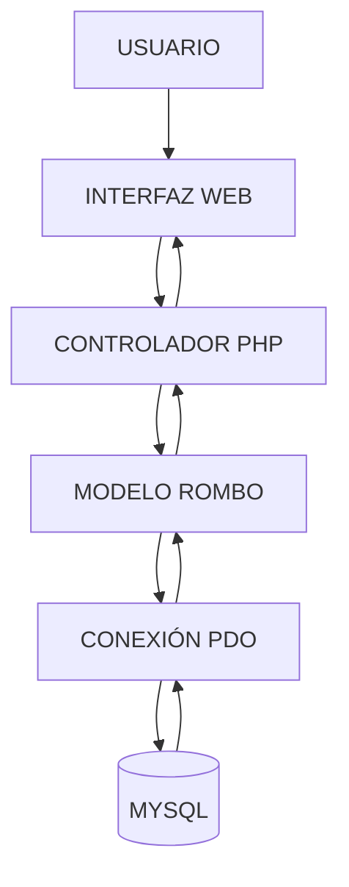

 <div align="center">


<br/>


<br/><br/>

**GEOMETRÍA INTELIGENTE · CÁLCULO AUTOMATIZADO · GESTIÓN DE REGISTROS**

</div>

---

<div align="center">


</div>

<table>
<tr>
<td bgcolor="#101A30" align="center">

### <font color="#38BDF8">◈ SISTEMA DEL ROMBO</font>

**Una solución web para el cálculo y administración de propiedades geométricas.**

El sistema permite introducir las diagonales de un rombo, procesar sus operaciones matemáticas y obtener resultados precisos. Además, integra autenticación y gestión de registros conectada a una base de datos MySQL.

</td>
</tr>
</table>

<div align="center">
<table>
<tr>
<td align="center" width="25%" bgcolor="#111C32">

<font color="#38BDF8">📐</font>

**CÁLCULO**

<sub>Propiedades geométricas</sub>

</td>
<td align="center" width="25%" bgcolor="#111C32">

<font color="#A78BFA">💾</font>

**REGISTRO**

<sub>Persistencia MySQL</sub>

</td>
<td align="center" width="25%" bgcolor="#111C32">

<font color="#2DD4BF">🔎</font>

**CONSULTA**

<sub>Búsqueda de datos</sub>

</td>
<td align="center" width="25%" bgcolor="#111C32">

<font color="#FBBF24">🔐</font>

**ACCESO**

<sub>Autenticación</sub>

</td>
</tr>
</table>
</div>

---

<div align="center">


### COMPONENTES DEL SISTEMA

<sub>SEIS OPERACIONES PARA ADMINISTRAR LA INFORMACIÓN</sub>

</div>

<table>
<tr>
<td width="50%" bgcolor="#101A30">


### 🔐 Autenticación

Acceso al sistema mediante credenciales de usuario.

</td>
<td width="50%" bgcolor="#101A30">


### 📐 Calculadora

Procesamiento de diagonales para obtener lado, área y perímetro.

</td>
</tr>
<tr>
<td width="50%" bgcolor="#101A30">


### 💾 Registro

Almacenamiento de resultados calculados.

</td>
<td width="50%" bgcolor="#101A30">


### 🔎 Búsqueda

Consulta de información previamente guardada.

</td>
</tr>
<tr>
<td width="50%" bgcolor="#101A30">


### ✏️ Actualización

Edición de los registros existentes.

</td>
<td width="50%" bgcolor="#101A30">


### 🗑️ Eliminación

Eliminación de registros almacenados.

</td>
</tr>
</table>

---

<div align="center">


### MOTOR MATEMÁTICO

<sub>FÓRMULAS UTILIZADAS PARA EL CÁLCULO GEOMÉTRICO</sub>

</div>

<table>
<tr>
<td align="center" bgcolor="#101A30">


# <font color="#38BDF8">A = (D × d) / 2</font>

**SUPERFICIE DEL ROMBO**

<sub>Producto de las diagonales dividido entre dos.</sub>

</td>
</tr>
<tr>
<td align="center" bgcolor="#101A30">


# <font color="#A78BFA">L = √((D/2)² + (d/2)²)</font>

**LONGITUD DEL LADO**

<sub>Aplicación del teorema de Pitágoras.</sub>

</td>
</tr>
<tr>
<td align="center" bgcolor="#101A30">


# <font color="#2DD4BF">P = 4 × L</font>

**PERÍMETRO TOTAL**

<sub>Cuatro veces la longitud de uno de sus lados.</sub>

</td>
</tr>
</table>

<div align="center">

| SÍMBOLO | DESCRIPCIÓN |
|:---:|:---|
| <font color="#38BDF8">D</font> | Diagonal mayor |
| <font color="#38BDF8">d</font> | Diagonal menor |
| <font color="#A78BFA">L</font> | Longitud del lado |
| <font color="#2DD4BF">A</font> | Área |
| <font color="#FBBF24">P</font> | Perímetro |

</div>

---

<div align="center">


### TECNOLOGÍAS DEL PROYECTO

<sub>HERRAMIENTAS Y TECNOLOGÍAS UTILIZADAS EN EL DESARROLLO</sub>

</div>

<table>
<tr>
<td align="center" bgcolor="#101A30" width="33%">


### PHP 8

<sub>Backend y lógica del sistema</sub>

</td>
<td align="center" bgcolor="#101A30" width="33%">


### MySQL

<sub>Base de datos relacional</sub>

</td>
<td align="center" bgcolor="#101A30" width="33%">


### HTML5

<sub>Estructura web</sub>

</td>
</tr>
<tr>
<td align="center" bgcolor="#101A30">


### CSS3

<sub>Diseño visual</sub>

</td>
<td align="center" bgcolor="#101A30">


### JavaScript

<sub>Interactividad</sub>

</td>
<td align="center" bgcolor="#101A30">


### XAMPP

<sub>Servidor de desarrollo local</sub>

</td>
</tr>
</table>

<div align="center">


<sub>Conexión y ejecución de consultas parametrizadas en PHP mediante PDO.</sub>

</div>

---

<div align="center">


### ESTRUCTURA DEL PROYECTO

<sub>ORGANIZACIÓN DEL CÓDIGO FUENTE POR RESPONSABILIDADES</sub>

</div>

<table>
<tr>
<td bgcolor="#101A30">

```text
SISTEMA-ROMBO/
│
├── config/
│   └── Database.php
│
├── controller/
│   └── Controladores PHP
│
├── model/
│   └── Rombo.php
│
├── views/
│   ├── login.php
│   └── home.php
│
├── database/
│   └── rombo_db.sql
│
├── assetes/
│   ├── css/
│   └── js/
│
└── README.md
```

</td>
</tr>
</table>

**CAPAS DE FUNCIONAMIENTO**



---

<div align="center">


### INSTALACIÓN Y EJECUCIÓN

<sub>CONFIGURACIÓN DEL ENTORNO DE DESARROLLO</sub>

</div>

<table>
<tr>
<td bgcolor="#101A30">

**01 / INICIAR SERVICIOS**

Activa Apache y MySQL desde el panel de control de XAMPP.

</td>
</tr>
<tr>
<td bgcolor="#101A30">

**02 / IMPORTAR BASE DE DATOS**

Ejecuta `database/rombo_db.sql` desde phpMyAdmin o MySQL Workbench.

</td>
</tr>
<tr>
<td bgcolor="#101A30">

**03 / CONFIGURAR CONEXIÓN**

Verifica los datos de `config/Database.php`.

```ini
HOST=127.0.0.1
PORT=3306
USER=root
```

</td>
</tr>
<tr>
<td bgcolor="#101A30">

**04 / INICIAR SERVIDOR**

Ejecuta desde la carpeta raíz del proyecto:

```bash
php -S 127.0.0.1:8000
```

</td>
</tr>
<tr>
<td bgcolor="#101A30">

**05 / ABRIR APLICACIÓN**

<div align="center">

[](http://127.0.0.1:8000/views/login.php)

`http://127.0.0.1:8000/views/login.php`

</div>

</td>
</tr>
</table>

---

<div align="center">


### CREDENCIALES DE PRUEBA

</div>

<table>
<tr>
<td align="center" bgcolor="#101A30" width="50%">

<sub>USER / EMAIL</sub>

# <font color="#38BDF8">admin@rombo</font>

</td>
<td align="center" bgcolor="#101A30" width="50%">

<sub>PASSWORD</sub>

# <font color="#A78BFA">123</font>

</td>
</tr>
</table>

<sub>Credenciales destinadas al entorno de pruebas local.</sub>

---

<div align="center">


# ANDRE MEZA

**SOFTWARE DEVELOPMENT**

<sub>Aplicaciones web · PHP · MySQL · Programación</sub>

<br/>


**SISTEMA DEL ROMBO — GEOMETRIC CALCULATION SYSTEM**

<sub>DESIGNED & DEVELOPED BY ANDRE MEZA</sub>

</div>
