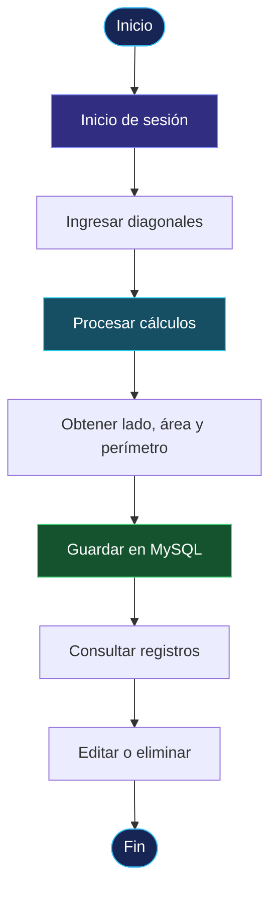

 
<div align="center">

# ◈ SISTEMA DEL ROMBO

### Aplicación web para el cálculo y la gestión de rombos

Sistema desarrollado con **PHP y MySQL** que permite calcular las propiedades geométricas de un rombo a partir de sus diagonales y administrar los resultados mediante un CRUD completo.

<br>


</div>

---

## 01. Descripción del proyecto

**Sistema del Rombo** es una aplicación web que permite ingresar las diagonales mayor y menor de un rombo para obtener automáticamente sus principales propiedades geométricas:

- Cálculo del lado.
- Cálculo del área.
- Cálculo del perímetro.
- Almacenamiento de resultados en MySQL.
- Búsqueda, edición y eliminación de registros.
- Inicio de sesión para acceder al sistema.

El proyecto integra operaciones matemáticas, conexión a base de datos y gestión de información mediante una arquitectura organizada en PHP.

## 02. Funcionalidades principales

| Módulo | Descripción |
|:---|:---|
| 🔐 Autenticación | Inicio de sesión para acceder a la aplicación. |
| 📐 Cálculos | Obtención del lado, área y perímetro del rombo. |
| 💾 Registro | Almacenamiento de los cálculos en MySQL. |
| 🔎 Búsqueda | Consulta de registros guardados. |
| ✏️ Edición | Actualización de información registrada. |
| 🗑️ Eliminación | Eliminación de registros del sistema. |

## 03. Fórmulas matemáticas

El sistema utiliza las siguientes fórmulas para realizar los cálculos:

**Área del rombo**

\[
A = \frac{D \times d}{2}
\]

**Lado del rombo**

\[
L = \sqrt{\left(\frac{D}{2}\right)^2+\left(\frac{d}{2}\right)^2}
\]

**Perímetro del rombo**

\[
P = 4 \times L
\]

Donde:

- `D`: diagonal mayor.
- `d`: diagonal menor.
- `L`: longitud del lado.
- `A`: área.
- `P`: perímetro.

## 04. Tecnologías utilizadas

| Tecnología | Aplicación |
|:---|:---|
| PHP 8 | Procesamiento y lógica del servidor. |
| PDO | Conexión y consultas a MySQL. |
| MySQL | Almacenamiento de usuarios y cálculos. |
| HTML5 | Estructura de las interfaces. |
| CSS3 | Diseño y presentación visual. |
| JavaScript | Interactividad del lado del cliente. |
| XAMPP | Entorno de desarrollo local. |

## 05. Arquitectura del proyecto

El proyecto está organizado por responsabilidades para facilitar su mantenimiento y comprensión.

```text
SISTEMA-ROMBO/
│
├── config/
│   └── Database.php
│
├── controller/
│   └── Controladores del sistema
│
├── model/
│   └── Rombo.php
│
├── views/
│   ├── login.php
│   └── home.php
│
├── database/
│   └── rombo_db.sql
│
├── assetes/
│   ├── css/
│   └── js/
│
└── README.md
```

## 06. Flujo de funcionamiento



## 07. Instalación y ejecución

### Requisitos

- PHP 8 o superior.
- MySQL.
- XAMPP.
- Navegador web.
- MySQL Workbench o phpMyAdmin (para importar la base de datos).

### Pasos de instalación

**1. Iniciar servicios**

Abre XAMPP y activa los servicios:

- Apache
- MySQL

**2. Crear la base de datos**

Abre MySQL Workbench o phpMyAdmin y ejecuta el archivo:

```text
database/rombo_db.sql
```

**3. Configurar la conexión**

Revisa el archivo `config/Database.php` y verifica los parámetros:

```text
Host:     127.0.0.1
Puerto:   3306
Usuario:  root
```

**4. Iniciar el servidor PHP**

Desde la terminal, ubícate en la carpeta del proyecto y ejecuta:

```bash
php -S 127.0.0.1:8000
```

**5. Acceder a la aplicación**

Abre en tu navegador:

```text
http://127.0.0.1:8000/views/login.php
```

## 08. Credenciales de acceso

<details>
<summary><strong>Ver credenciales de prueba</strong></summary>

| Campo | Credencial |
|:---|:---|
| Correo | `admin@rombo` |
| Contraseña | `123` |

</details>

> Estas credenciales son para el entorno de prueba local.

## 09. Autor

<div align="center">

### ANDRE MEZA

Desarrollo de software · Aplicaciones web · PHP · MySQL

---

**Sistema del Rombo**

*Proyecto de desarrollo web orientado al cálculo geométrico y gestión de datos.*

</div>
